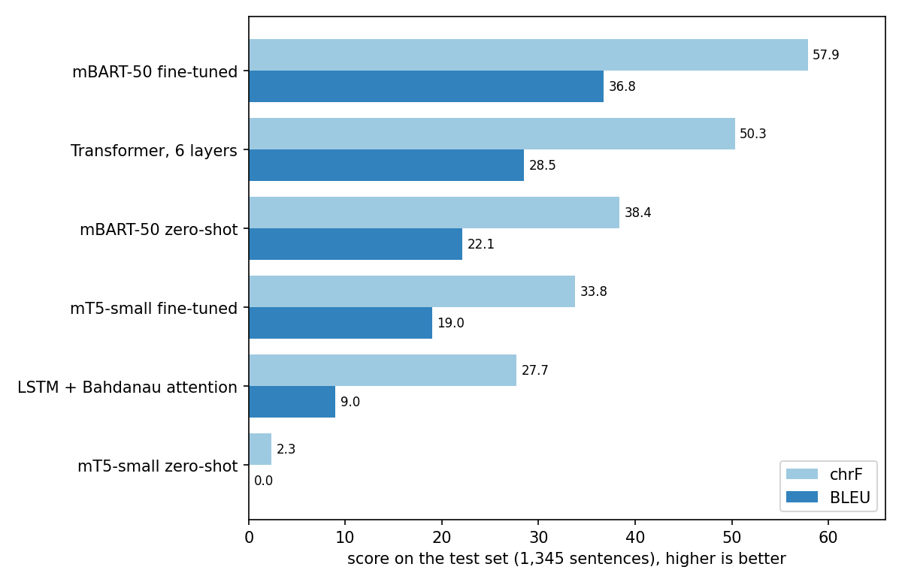

# Hinglish to English Machine Translation: pretraining versus training from scratch

Group 8 (P08): Swati Kumari, Pinky Rana, Vinay Kumar, Ujjval Baijal.
Code, results and history: this repository. All numbers below come from the files in `results/`
and can be regenerated with `python src/compare.py`.

## 1. Summary

We translate Roman-script, code-mixed Hinglish tweets into English with four systems that all use
the same data split and the same scoring: a seq2seq LSTM with Bahdanau attention and a Transformer,
both trained from scratch, and mBART-50 and mT5-small, both pretrained and fine-tuned. On the
1,345-sentence test set the fine-tuned mBART-50 is best (36.76 BLEU, 57.87 chrF), the Transformer
trained from scratch is second (28.51 BLEU), then fine-tuned mT5-small (18.97) and the LSTM (8.97).
So pretraining helped clearly for mBART-50, but not for every pretrained model: our mT5-small
result is below the from-scratch Transformer. All results are single runs on one dataset.

## 2. Problem and research question

Hinglish writes Hindi in Latin letters, mixes in English words and has no fixed spelling
(`kya`, `kyaa`). Parallel data is small and noisy. **Research question:** how much does pretraining
help on a low-resource, code-mixed translation task compared with training from scratch?

## 3. Data

We use PHINC (Srivastava and Singh, W-NUT 2020), about 13.7k Hinglish-English sentence pairs of
social media text (13,738 raw rows).

**Cleaning.** Reviews of our own pipeline found problems in the raw file, which we fixed before any
final training: HTML codes (`&amp;`, `&lt;`) were decoded; 234 pairs whose English side was only
`)`, `$` or `-)` were dropped (a model trained on them learned to output `)`); 51 pairs where the
tweet had been cut at `&amp;` and the two sentences were two halves of one English sentence were
dropped; exact duplicate pairs were removed; URLs became `<url>`; text was lowercased.

**Split.** 80/10/10 with seed 42: 10,762 train, 1,345 validation, 1,345 test pairs. Sentences are
about 13 words long on average. About 28% of the Hinglish words also appear unchanged in the English
sentence, which shows how much English is mixed in. Statistics: `results/eda.txt`.

## 4. Methods

All models read the same `train.tsv`, are tuned on `val.tsv` and are scored once on `test.tsv`.
Vocabularies and tokenizers are built from the training split only.

**LSTM with Bahdanau attention (Pinky).** Bidirectional LSTM encoder, LSTM decoder with additive
attention (Bahdanau et al., 2015), word-level vocabularies (words seen at least twice), embedding
256, decoder 512, dropout 0.3, Adam 1e-3, batch 64, label smoothing 0.1, early stopping (it stopped at
epoch 15). About 12% of the English training words are rare and become `<unk>`, so `<unk>` is blocked
during decoding; this raised BLEU from 6.50 to 8.97. Decoding: beam search, size 5.

**Transformer from scratch (Ujjval).** Encoder-decoder built from `torch.nn` layers, with our own
sinusoidal positional encoding, causal and padding masks, one shared embedding for source, target and
output, greedy and beam search. Joint SentencePiece BPE vocabulary of 4,000 pieces trained on the
training split. d_model 256, 4 heads, feed-forward 1024, dropout 0.3, label smoothing 0.1, warmup
learning rate, up to 40 epochs. Two settings were compared (3 + 3 and 6 + 6 layers); the 6-layer one is
reported. Trained on CPU.

**Fine-tuned pretrained models (Vinay).** mBART-50 (`facebook/mbart-large-50-many-to-many-mmt`, source
tag Hindi) for 3 epochs and mT5-small (`google/mt5-small`, with a text prefix) for 5 epochs, both with
learning rate 3e-5, batch 8 with gradient accumulation 4 and beam 4 on a Colab T4 GPU. Each model was
also evaluated zero-shot, without any training. IndicTrans2 and a Roman-to-Devanagari transliteration
experiment were prepared in the code but not run.

**Evaluation.** sacreBLEU BLEU and chrF through one shared function. Predictions and references are
lowercased before scoring, so models that output capitalised English are not penalised (this was a
bug found in review: without it the pretrained models would have been scored unfairly low).

## 5. Results

Test set, 1,345 sentences. Higher is better.

| Rank | Model | Trained by | How | BLEU | chrF |
| --- | --- | --- | --- | --- | --- |
| 1 | mBART-50 fine-tuned | Vinay | pretrained + fine-tuned | 36.76 | 57.87 |
| 2 | Transformer, 6 layers (beam 5) | Ujjval | from scratch | 28.51 | 50.32 |
| 3 | mBART-50 zero-shot | Vinay | pretrained, no training | 22.14 | 38.35 |
| 4 | mT5-small fine-tuned | Vinay | pretrained + fine-tuned | 18.97 | 33.79 |
| 5 | LSTM + Bahdanau attention (beam 5) | Pinky | from scratch | 8.97 | 27.71 |
| 6 | mT5-small zero-shot | Vinay | pretrained, no training | 0.01 | 2.33 |



Other numbers: beam search beat greedy decoding by 1.3 BLEU for the LSTM (8.97 against 7.64) and by
1.6 for the Transformer (28.51 against 26.91). The 3-layer Transformer scored 28.43 BLEU and 49.77
chrF, practically the same as the 6-layer one.

## 6. Error analysis

For each model the 50 worst translations (lowest sentence chrF) were tagged by hand. The categories
were chosen by the person tagging each model, so the columns are comparable only roughly, and the table
shows the worst sentences, not all errors.

| Error category | LSTM | Transformer | mT5-small | mBART-50 |
| --- | --- | --- | --- | --- |
| Wrong meaning | 17 | 20 | | 21 |
| Noisy reference | 9 | 13 | 3 | 14 |
| Dropped words | 2 | 1 | 24 | 1 |
| Junk output | 14 | 2 | 10 | |
| Repetition | 4 | 1 | 13 | 1 |
| Hindi word left untranslated | | 11 | | |
| Wrong word choice | 1 | 1 | | 5 |
| Transliteration error | | | | 5 |
| English not copied | 3 | | | |
| Code-mixing issue | | | | 3 |
| Correct but worded differently | | 1 | | |

Real examples of each category are in `results/error_examples.md`. What the table shows:

- **mBART-50** writes fluent English; its worst cases are mostly a wrong meaning for a colloquial
  phrase, or a noisy reference.
- **mT5-small** mostly drops words or repeats itself, often copying only a mention or a few characters.
- **The Transformer** almost never produces junk, but when it does not know a Hindi word it often
  copies it into the English (for example `mobarak ied mobarak ??` for "happy eid"), because the BPE
  vocabulary is shared by both languages.
- **The LSTM** produces junk output such as `) :p` (14 of 50). The LSTM's own README notes say this
  comes from training on emoticon-only references.
- **Noisy references** are a large share of every model's worst cases (3 to 14 of 50). Example: the
  reference of `rt @sheikhimaan : news flash : iss baar bheja tha . jeet gaye .` is only `) <url>`.

## 7. Discussion

**Does pretraining help?** For mBART-50, yes: fine-tuned mBART-50 is 8.25 BLEU above the best
from-scratch model, and fine-tuning added 14.62 BLEU over its zero-shot score. Even zero-shot mBART-50
(22.14) beats the LSTM by a wide margin. For mT5-small the answer is no: zero-shot it is useless
(0.01 BLEU), and after fine-tuning (18.97) it stays 9.54 BLEU below the from-scratch Transformer. Likely
reasons are that mT5-small is a small model whose pretraining is not translation, and that we used a
learning rate (3e-5) lower than the 3e-4 that is usual for mT5, so it may be under-tuned. We did not test
this. So the honest answer is that a pretrained model that was trained for translation (mBART-50)
helps a lot, while a small general-purpose model does not necessarily.

**From scratch can work.** The from-scratch Transformer, with only about 10.8k training pairs, reached
28.51 BLEU, above zero-shot mBART-50. Its BPE vocabulary is probably a big part of this: the LSTM, with a
word-level vocabulary, loses many rare words to `<unk>`. The 19.5 BLEU gap between LSTM and Transformer is
therefore a mix of architecture and tokenization; we did not run an LSTM with BPE to separate the two.

## 8. Limitations

- **Single run per model**, one seed. Differences of a few tenths of BLEU (such as the 0.08 BLEU between the
  3-layer and 6-layer Transformer) are not meaningful. We did not compute confidence intervals or
  significance tests, because only the 100 worst predictions per model are saved, not all test predictions.
- **Noisy references.** PHINC translations are sometimes wrong or only loosely aligned, which lowers all
  scores. 10 of the 1,345 test references (0.74%) contain no real word at all (only emoticons, mentions,
  hashtags or `<url>`); we left them in so that all models were scored on the same fixed split. Removing
  them would change the split again.
- **mT5 not tuned**; **IndicTrans2 not run**; no transliteration experiment.
- **Different taggers.** Each model's errors were tagged by a different person with their own categories.
- **One dataset** of social media text; the results may not hold for other kinds of Hinglish text.
- Not done: training on smaller fractions of the data to see where pretraining helps most, and
  breaking scores down by sentence length or amount of code-mixing.

## 9. Conclusion

On PHINC, a pretrained translation model fine-tuned on our small training set (mBART-50, 36.76 BLEU) is
clearly better than a Transformer trained from scratch (28.51 BLEU), which in turn is far better than an
LSTM with attention (8.97 BLEU). The result does not extend to every pretrained model, since fine-tuned
mT5-small (18.97 BLEU) is below the from-scratch Transformer. The most useful lessons of the project
were about data: cleaning the raw file (junk translations, cut tweets, HTML codes) and scoring all models
in exactly the same way changed the conclusions we could trust.

## 10. Team and process

| Member | Work |
| --- | --- |
| Swati Kumari | Repo and data pipeline (download, cleaning, fixed split, vocabulary helper), shared BLEU/chrF evaluation, tests, GitHub Actions CI, README, comparison script and this report |
| Pinky Rana | LSTM with Bahdanau attention and its results and error analysis; reviews that found the lowercase bug, the junk translations and the cut tweets in the data |
| Vinay Kumar | Fine-tuning code for mBART-50, mT5 and IndicTrans2; Colab notebook; fine-tuned and zero-shot results and error analysis for mBART-50 and mT5 |
| Ujjval Baijal | Transformer from scratch, two settings compared, its results and error analysis |

We worked with one GitHub issue and one pull request per task, no direct pushes to `main`, a green
`tests` check and a teammate review before merging, and a shared split and evaluation function so that
the numbers can be compared.

## 11. How to reproduce

```bash
pip install -r requirements.txt
python src/download_data.py && python src/preprocess.py
python src/train_lstm.py                                          # Colab GPU recommended
python src/train_transformer.py --config configs/transformer_deep.json
python src/finetune.py --model mbart --epochs 3                   # and --model mt5 --epochs 5, --epochs 0 for zero-shot
python src/compare.py                                             # tables and chart from results/
```

## References

1. Bahdanau, Cho, Bengio. Neural Machine Translation by Jointly Learning to Align and Translate. ICLR 2015. <https://arxiv.org/abs/1409.0473>
2. Srivastava, Singh. PHINC: A Parallel Hinglish Social Media Code-Mixed Corpus for Machine Translation. W-NUT 2020. <https://arxiv.org/abs/2004.09447>
3. Vaswani et al. Attention Is All You Need. NeurIPS 2017. <https://arxiv.org/abs/1706.03762>
4. Tang et al. Multilingual Translation with Extensible Multilingual Pretraining and Finetuning (mBART-50). 2020. <https://arxiv.org/abs/2008.00401>
5. Xue et al. mT5: A Massively Multilingual Pre-trained Text-to-Text Transformer. NAACL 2021. <https://arxiv.org/abs/2010.11934>
6. Sennrich, Haddow, Birch. Neural Machine Translation of Rare Words with Subword Units. ACL 2016. <https://arxiv.org/abs/1508.07909>
7. Kudo, Richardson. SentencePiece. EMNLP 2018 (demo). <https://arxiv.org/abs/1808.06226>
8. Post. A Call for Clarity in Reporting BLEU Scores (sacreBLEU). WMT 2018. <https://arxiv.org/abs/1804.08771>
9. Popovic. chrF: character n-gram F-score for automatic MT evaluation. WMT 2015.
